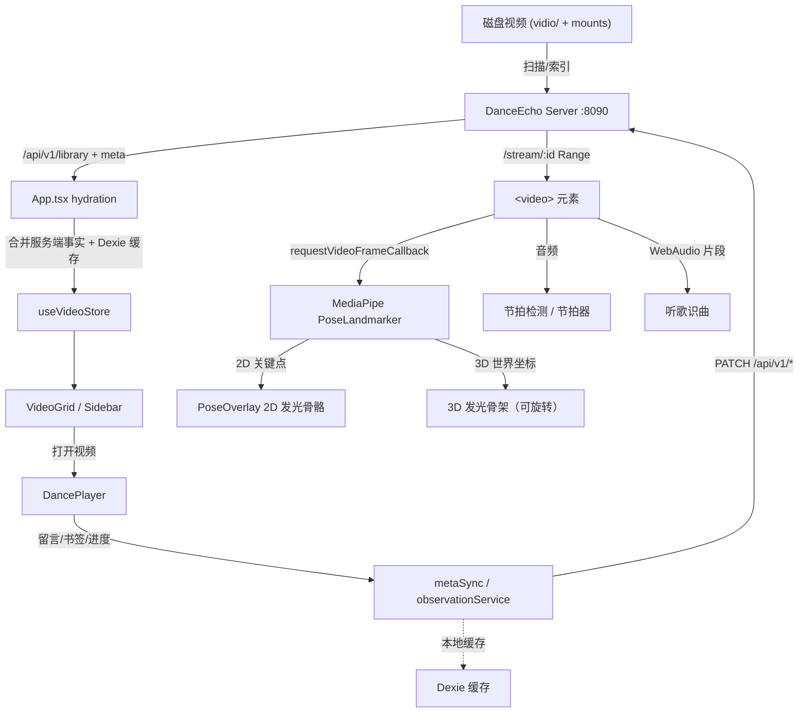

# PROJECT_STRUCTURE — 主前端源码结构与数据流

> 唯一可信源：`local vidio store/`（前端）+ `DanceEcho Server/`（后端）。
> 整体架构、端口与启动见根目录 `README.md`。本文件只描述**前端源码**。
> 旧版本曾描述「纯前端 IndexedDB + β 原型」，已作废。

---

## 1. 技术栈

React 19 · TypeScript 5.7 · Vite 6 · TailwindCSS 3 · zustand 5（全局状态）·
Dexie 4（本地元数据缓存）· three 0.164（3D 发光骨架）·
@mediapipe/tasks-vision（姿态）· Playwright（E2E）。

> **2026-11-07 起**：实时 VRM 数字人驱动已下线，`@pixiv/three-vrm` 与
> `kalidokit` 依赖已移除；动作数据出口统一为 `services/pose/bvhExport.ts` 的
> BVH 导出。`src/scene/vrm-controller.ts` 为遗留文件名，只导出
> `Skeleton3DController`（纯 3D 骨架可视化）。

**分层**：`components/`（视图）→ `store/` + `hooks/`（状态与副作用）→
`services/`（pose/audio/music/ai/api/storage/settings）→ `services/api/`（后端客户端）。
重组件（DancePlayer、DanceBuddyDrawer、SettingsModal）在 `App.tsx` 里 `lazy()` 懒加载，
首页不加载 three/mediapipe 的大 chunk（见 `vite.config.ts` 的 `manualChunks`）。

---

## 2. 目录树（`local vidio store/src/`）

```
src/
├── App.tsx                     顶层容器：初始化 hydration、导入流程、视图调度、toast
├── main.tsx                    挂载入口
├── index.css                   全局样式 / 设计 token
├── types/                      VideoItem 等领域类型；file-system-access 类型声明
├── i18n/                       I18nContext、phrases.ts / phrasesUi.ts、DOM 短语翻译
│
├── components/
│   ├── gallery/                VideoGrid（119KB 网格/虚拟滚动）、VideoCard、FilterBar、
│   │                           TagFilterBar、TagFilter、CoverFallback 等
│   ├── player/                 DancePlayer（104KB 播放器主组件）、DancePlayerRightDrawer、
│   │                           DualVideoCompareModal、BeatMetronome、PoseOverlay 等
│   ├── scene/                   Three.js 场景、3D 发光骨架控制器（见 src/scene/）
│   ├── sidebar/                Sidebar、FolderTree、TrashModal、分组/打卡热力图
│   ├── common/                 ErrorBoundary、LanguageToggle、FolderDialogs、通用 UI
│   ├── music/                  SongPreviewPlayer、SongRecognizeModal
│   ├── ai/                     DanceBuddyDrawer（AI 对话）
│   └── settings/               SettingsModal（AI/歌曲/标签/存储/性能/关于）
│
├── store/useVideoStore.ts      zustand：视频集合、当前视频、分组、toast、留言计数
├── hooks/usePoseTracker.ts     MediaPipe 逐帧姿态追踪、平滑滤波、多人/ROI
│
├── scene/                      scene-manager.ts、vrm-controller.ts（遗留文件名，导出 Skeleton3DController；3D 渲染循环）
├── services/
│   ├── api/                    client.ts（/api/v1 全量 API）、serverUrl.ts（8090 地址）、
│   │                           idMap.ts、metaSync.ts、folderSync.ts（虚拟路径⇄扁平文件夹）
│   ├── db.ts / storage/        Dexie 缓存、webAdapter、storageManager（备份/恢复）、
│   │                           observationService、practiceLogService、tagConfig
│   ├── pose/                   pose-detector、pose-overlay、one-euro-filter、
│   │                           poseTrackService、bvhExport
│   ├── audio/                  beatDetector、beatAnalysis、beatGridStore、mediaClock
│   ├── music/                  songService（内置曲库 + 代理搜索 + ACRCloud）
│   ├── ai/                     llmClient（经 /api/llm/* 本地代理）
│   ├── settings/               appPreferences
│   ├── thumbnail.ts           视频元信息/封面提取
│   └── demoVideoGenerator.ts  演示视频
│
└── utils/                      poseAngles、displayTitle、tagLibrary、favorites、
                                continueWatching、tagDisplay
```

`scripts/`（工程根，非 src）：Playwright E2E 全套 + 一次性取证/契约校验脚本，
`run-e2e-all.mjs` 统一编排；`fixtures/1.mp4` 是固定测试视频。

---

## 3. 数据流



**关键点**：
- 视频本体不进入浏览器存储：`<video src="/stream/:id">` 由后端按 Range 直读磁盘。
- 服务端 `data/meta.json` 是元数据事实源；本地 Dexie 仅缓存，写操作经 `metaSync` 同步回服务端。
- 导入 = 上传到服务端 `uploads/`（multipart）→ 后端重扫入库；浏览器不保存 Blob。
- 2D/3D 姿态在**播放时实时**从 `<video>` 帧解算，不预生成、不落盘。

---

## 4. 维护约定

1. **绝对主次**：新功能、修复、测试只在 `local vidio store/` 与 `DanceEcho Server/` 内改动。
2. **选择器契约**：`VideoCard` 的 `.video-card`、播放器控制栏等保留语义类名/`data-testid`，
   保证 `scripts/` 下 Playwright 脚本稳定。
3. **内存安全**：任何 `URL.createObjectURL(blob)` 在组件卸载/切换时必须 `revokeObjectURL`。
4. **API 契约**：新增后端能力先扩 `services/api/client.ts`，前端不直接拼接 `/api/v1` URL。
5. **测试**：改播放器/姿态/存储后跑 `npm test`；E2E 依赖 `fixtures/1.mp4` 与 8090/5173 常驻。
6. **忽略规则**：`node_modules/`、`dist/`、`DanceEcho Server/data/`、`vidio/*.mp4`、
   `.scratch/`、截图与临时目录见根 `.gitignore`，勿提交。
